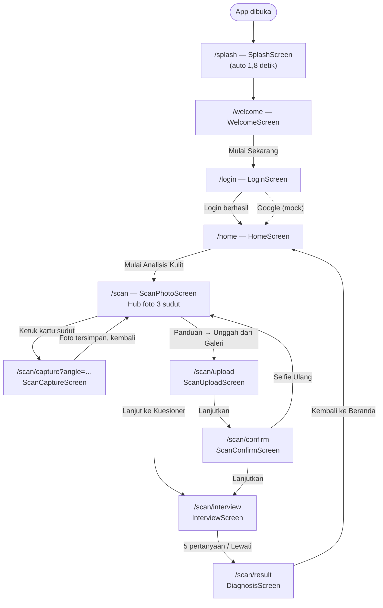
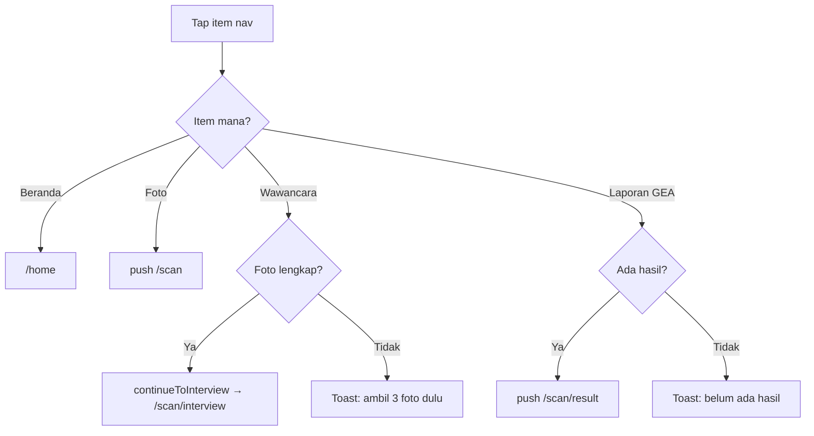

# Alur Pengguna & Navigasi

## Diagram Alur Utama

## Langkah demi Langkah

### 1. Splash → Welcome

`SplashScreen` menampilkan logo & nama aplikasi, lalu `Timer` 1.800 ms
otomatis `context.go('/welcome')`.

`WelcomeScreen` memperkenalkan 3 fitur (Scan 3 sudut, Interview singkat, Hasil
skala GEA) dan tombol **Mulai Sekarang** → `/login`.

### 2. Login

`LoginScreen` memakai `AuthCubit`. Saat submit, layar otomatis menyalakan
centang S&K + privasi (`togglePrivacy(true)`, `toggleTerms(true)`) lalu memanggil
`login(...)`. Bila status menjadi `authenticated`, `listener` melakukan
`context.go('/home')`.

- **Email/password** — divalidasi di UI secara *live*: field yang kosong atau
  email yang formatnya salah memunculkan **bubble kecil** tepat di atas field
  bersangkutan (bukan panel). Pengecekan berjalan saat field ditinggalkan
  (blur), saat tombol **Masuk** ditekan, atau saat isi field dikosongkan
  kembali.
- **Kredensial salah** — bila field sudah valid tetapi email/kata sandi tidak
  cocok dengan akun demo, service melempar `AuthException` dan layar
  menampilkan **panel merah** (`Alert.destructive`) **di antara judul
  "Masuk ke Akun Anda" dan card form**. Panel ini otomatis hilang begitu
  pengguna mengetik ulang.
- **Akun demo** — `pengguna@gmail.com` / `skinscan123`.
- **Google** — *mock*: langsung login dengan email contoh
  `pengguna@gmail.com` (`viaGoogle: true`, sehingga pemeriksaan kredensial
  dilewati).
- Tombol **Daftar Sekarang** memunculkan toast "Belum tersedia di versi
  prototipe."
- **Tata letak** — halaman login tidak *scrollable* pada layar normal. Konten
  memadat secara proporsional lewat `LayoutBuilder` (skala `maxHeight / 600`,
  dibatasi `0.85`–`1.0`) dan `FittedBox(scaleDown)` sebagai jaring pengaman.
  `FittedBox` baru benar-benar mengecil karena tingginya dikunci
  `SizedBox(height: maxHeight)`; tanpa pengunci itu scroll view meneruskan
  tinggi **tak terbatas** sehingga `scaleDown` jadi *no-op* dan sisa konten
  terpotong diam-diam (tanpa overflow error). Pengunci inilah yang menjaga
  panel galat kredensial, bubble inline, dan tautan "Daftar Sekarang" tetap
  utuh.
- **Dua mode tata letak** — mode *fit* (tinggi dikunci, tanpa geser) dipakai
  hanya kalau konten masih muat pada skala terbaca: area konten ≥ `570` px
  saat normal, dan ≥ `720` px saat ada pesan galat (panel/bubble menambah
  tinggi konten). Di bawah ambang itu konten **bisa digeser**
  (`ClampingScrollPhysics`) dan tetap pada skala terbaca, bukan menyusut
  sampai tak terbaca (mis. panel galat di 320×568: 0,60 → 0,85). Mode
  ditentukan per keadaan, jadi 360×640 tetap tidak bisa digeser saat idle
  tetapi bisa digeser begitu galat muncul.
- **Keyboard** — `resizeToAvoidBottomInset: false` membuat tinggi tata letak
  selalu dihitung dari tinggi penuh, jadi mengetik **tidak** menggeser atau
  menyusutkan konten. Scroll hanya aktif saat keyboard terbuka atau layar
  pendek (`ClampingScrollPhysics`) agar field, tombol, dan tautan terbawah
  tetap terjangkau; saat idle di layar normal scroll terkunci
  (`NeverScrollableScrollPhysics`). Struktur widget dijaga tetap sama supaya
  `TextField` tidak kehilangan fokus.

### 3. Beranda

`HomeScreen` mengelola 3 tab lewat `HomeCubit` (bukan bottom nav):

| Tab | Cara membuka |
|---|---|
| Beranda (`_tabHome`) | Default |
| Artikel (`_tabArticles`) | Ketuk kartu **Tentang Skala Global Acne (GEA)** |
| Profil (`_tabProfile`) | Ketuk avatar di `AppHeader` |

Kartu **Mulai Analisis Kulit** memulai alur scan (`/scan`).

### 4. Alur Scan (2 jalur)

Ada **dua cara** mengumpulkan 3 foto, dan keduanya bertemu di interview.

**Jalur A — Kamera langsung (per sudut):**

1. `/scan` (`ScanPhotoScreen`) menampilkan 3 kartu sudut: **Tampak Depan**,
   **Sisi Kiri**, **Sisi Kanan**. Kartu terkunci sampai sisi sebelumnya selesai
   (kiri butuh depan; kanan butuh kiri).
2. Ketuk kartu → `/scan/capture?angle=<front|left|right>`.
3. `ScanCaptureScreen` menganalisis frame kamera (ML Kit): indikator **Cahaya**,
   **Wajah**, **Sudut** harus hijau. Bila siap, muncul hitungan **3-2-1** dan
   foto diambil otomatis (atau lewat tombol).
4. Setelah tersimpan, layar `pop()` kembali ke hub. Ulangi untuk 3 sudut.
5. Tombol **Lanjut ke Kuesioner (Langkah 2)** → `continueToInterview()` →
   `/scan/interview`.

**Jalur B — Unggah dari galeri:**

1. Di `/scan`, tombol **Panduan Ulang Foto** membuka dialog; pilih **Unggah dari
   Galeri** → `/scan/upload`.
2. `ScanUploadScreen` menyediakan 3 slot (depan/kiri/kanan). Tombol
   **Lanjutkan** aktif setelah 3 foto → `/scan/confirm`.
3. `ScanConfirmScreen` menampilkan pratinjau + **Lanjutkan** → interview, atau
   **Selfie Ulang** → `retakePhotos()` → `/scan`.

> Pada kamera mode berurutan (`/scan/capture` tanpa `angle`), setelah 3 sudut
> selesai alur juga melewati `/scan/confirm`.

### 5. Interview (chat)

`InterviewScreen` adalah chat 5 pertanyaan dengan indikator progres. Setiap
jawaban langsung tersimpan ke `ScanSession.interview`.

| # | Pertanyaan | Nilai yang disimpan |
|---|---|---|
| 0 | Jenis kelamin | `gender` |
| 1 | Umur | `age` |
| 2 | Pakai sunscreen | `usesSunscreen` |
| 3 | Tipe kulit | `skinType` |
| 4 | Sering makanan pemicu | `unhealthyFoodOften` |

Tombol **Lewati** memanggil `skipInterview()` (jawaban `skipped: true`) dan
langsung diagnosa.

### 6. Hasil

Setelah pertanyaan ke-5, `ScanCubit` masuk fase `diagnosing` lalu `result`, dan
`InterviewScreen` otomatis `context.go('/scan/result')`.

`DiagnosisScreen` menampilkan: pratinjau foto depan, `GeaResultBadge` (angka
besar + label), `GeaScaleBar` 0–5, penjelasan grade, dan catatan bahwa hasil
masih rule-based. Tombol **Kembali ke Beranda** memanggil `resetFlow()` lalu
`/home`.

## Bottom Navigation

`AppBottomNav` dipakai di layar beranda dan hub foto. Itemnya:

| Indeks (`NavIndex`) | Label | Aksi (`handleBottomNavTap`) |
|---|---|---|
| `home` (0) | Beranda | `onHome()` atau `go('/home')` |
| `photo` (1) | Foto | `push('/scan')` (bila belum di sana) |
| `interview` (2) | Wawancara | Lanjut interview bila foto lengkap; jika belum → toast |
| `report` (3) | Laporan GEA | Buka hasil bila sudah ada; jika belum → toast |

