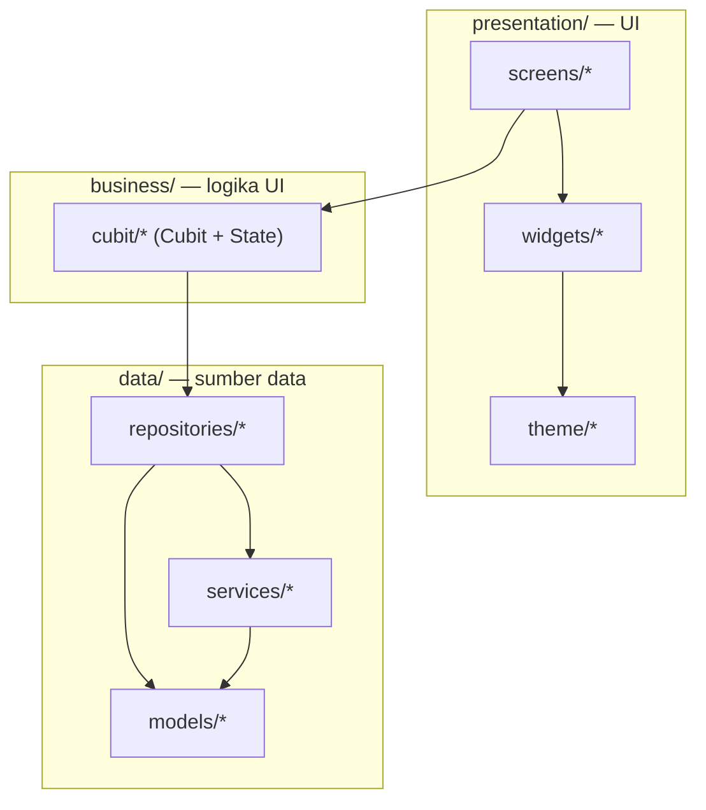
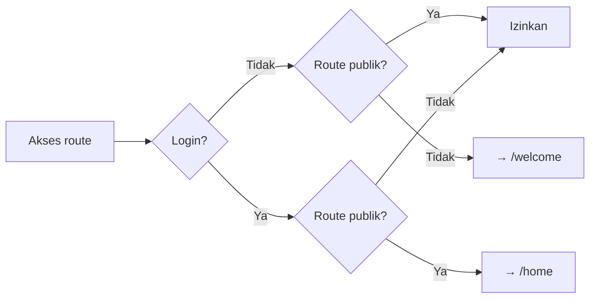
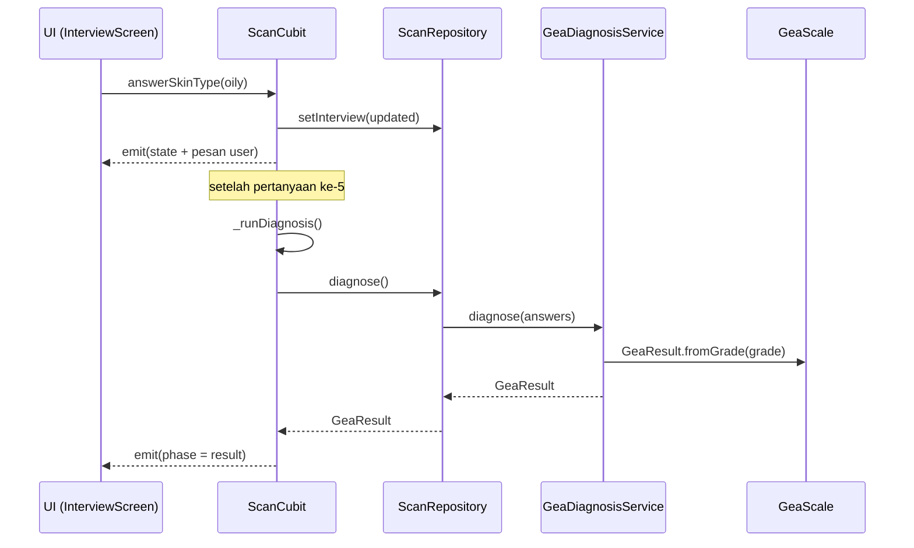

# Arsitektur

Aplikasi memakai pola **berlapis (layered)** dengan pemisahan tegas antara
data, logika bisnis, dan tampilan. Arah dependensi selalu dari luar ke dalam:

```
presentation  →  business  →  data
   (UI)          (Cubit)      (models, repositories, services)
```

Lapisan UI tidak pernah memanggil *service* secara langsung; ia selalu lewat
Cubit.

## Diagram Lapisan



## Titik Masuk & Dependency Injection

`lib/main.dart` melakukan **DI manual** (tanpa `get_it`/`provider` paket lain):
repository dibuat sekali di `initState`, lalu Cubit di-*provide* ke seluruh
widget lewat `MultiBlocProvider`.

```dart
// main.dart (ringkas)
_authRepository = AuthRepository(AuthService());
_scanRepository = ScanRepository(GeaDiagnosisService());
_authCubit      = AuthCubit(_authRepository);
_scanCubit      = ScanCubit(_scanRepository);
_router         = createRouter(_authCubit);
```

`AuthCubit` dan `ScanCubit` berumur **sepanjang aplikasi** (lifecycle widget
root) dan di-`close()` di `dispose`. `HomeCubit` berbeda: dibuat per-route di
`/home` karena hanya mengatur tab lokal.

Aplikasi di-*render* lewat `ShadcnApp.router` dengan `themeMode: ThemeMode.light`
dan `routerConfig: _router`.

## State Management — Cubit

Tiga Cubit, masing-masing dengan State `Equatable`-nya:

| Cubit | State | Tanggung jawab | Umur |
|---|---|---|---|
| `AuthCubit` | `AuthState` | Login/logout, status sesi, centang S&K | App-wide |
| `ScanCubit` | `ScanState` | Seluruh alur scan: foto → interview → hasil | App-wide |
| `HomeCubit` | `HomeState` | Tab aktif di beranda | Per-route `/home` |

**Pola umum setiap state:** field `copyWith(...)` dengan flag `clearError` /
`clearUser` / `clearPhotos` untuk membedakan "tidak diubah" dari "di-set null".
Semua state `extends Equatable` agar rebuild hanya terjadi saat nilai berubah.

`ScanCubit` menyimpan satu field non-state: `leftYawSign` (tanda yaw saat foto
sisi kiri diambil) — dipakai lintas layar kamera untuk memvalidasi sisi kanan.

### Fase alur scan (`ScanPhase`)

`ScanState.phase` adalah mesin status alur scan:

```
intro → capturing → confirming → interviewing → diagnosing → result
                └→ uploading → confirming
```

| Fase | Arti |
|---|---|
| `intro` | Belum mulai / kembali ke hub foto |
| `capturing` | Mengambil foto via kamera langsung |
| `uploading` | Mengunggah foto dari galeri |
| `confirming` | 3 foto siap, menunggu konfirmasi |
| `interviewing` | Sedang menjawab 5 pertanyaan chat |
| `diagnosing` | Sedang menghitung hasil (mock delay) |
| `result` | Hasil GEA tersedia |

## Routing — go_router

`lib/app_router.dart` membuat `GoRouter` dengan **redirect guard** berbasis
`AuthCubit`.



- **Route publik:** `/splash`, `/welcome`, `/login`.
- Router mendengarkan perubahan auth via `_AuthRefresh` (sebuah
  `ChangeNotifier` yang men-subscribe stream `AuthCubit`), sehingga login/logout
  otomatis memicu evaluasi ulang redirect.

| Path | Layar | Catatan |
|---|---|---|
| `/splash` | `SplashScreen` | Auto ke `/welcome` setelah 1,8 detik |
| `/welcome` | `WelcomeScreen` | |
| `/login` | `LoginScreen` | |
| `/home` | `HomeScreen` | Dibungkus `HomeCubit` |
| `/scan` | `ScanPhotoScreen` | Hub foto 3 sudut |
| `/scan/capture` | `ScanCaptureScreen` | Query `angle=front\|left\|right` |
| `/scan/upload` | `ScanUploadScreen` | |
| `/scan/confirm` | `ScanConfirmScreen` | |
| `/scan/interview` | `InterviewScreen` | |
| `/scan/result` | `DiagnosisScreen` | |

`ScanCaptureScreen` menerima sudut target lewat query string; bila `angle`
kosong, layar berjalan mode "3 sudut berurutan".

## Alur Data (contoh: membuat diagnosa)



## Repository & Service

- **Repository** = pemilik state sesi (in-memory) + orkestrasi service.
  - `AuthRepository`: menyimpan `_currentUser`, meneruskan login ke `AuthService`.
  - `ScanRepository`: menyimpan `_session` (`ScanSession`), mengatur foto,
    interview, dan memanggil diagnosa.
- **Service** = logika murni / akses platform, tanpa menyimpan state aplikasi.
  - `AuthService` — validasi login mock.
  - `GeaDiagnosisService` — hitung grade GEA (rule-based).
  - `FaceScanAnalyzer` — ML Kit: cahaya, keberadaan wajah, sudut.
  - `ImagePickService` — ambil gambar dari kamera/galeri.

## Tema

`lib/presentation/theme/` berisi token terpusat:

- `app_colors.dart` — palet brand (blush/crimson) + `gradeColor(0..5)` dan
  `onGrade(g)` untuk warna tingkat keparahan, serta `dangerSurface`/`dangerInk`
  untuk permukaan galat yang tetap terbaca.
- `app_theme.dart` — `ThemeData` shadcn (`ColorScheme` brand + tipografi).
- `app_font.dart` — helper `appFont(...)` untuk `TextStyle` manual
  (Plus Jakarta Sans, bobot eksplisit agar tidak faux-bold).

Detail warna & font ada di [panduan-pengembangan.md](panduan-pengembangan.md).
