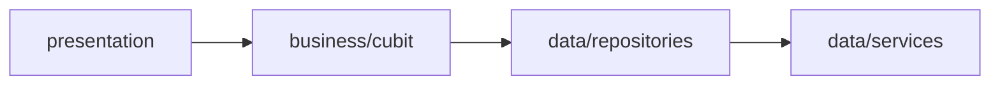

# Panduan Pengembangan

## Konvensi Kode

| Elemen | Gaya | Contoh |
|---|---|---|
| Nama file | `snake_case` | `scan_photo_screen.dart` |
| Kelas | `PascalCase` | `ScanCubit`, `GeaResultBadge` |
| Anggota / variabel | `camelCase` | `interviewStep`, `hasAllPhotos` |
| Konstanta privat | `_camelCase` | `_tabHome`, `_order` |
| Widget privat | awalan `_` | `_AngleCard`, `_StatusChip` |
| Kelas token/konstanta | `abstract final class` | `AppColors`, `GeaScale`, `NavIndex` |
| Import | absolut via package | `package:pbl_skin_problem_detector/...` |

**Aturan umum:**

- Selalu impor lewat `package:pbl_skin_problem_detector/...`, bukan path relatif.
- Widget yang hanya dipakai satu layar dibuat **privat** (`_Nama`) di file yang
  sama, bukan di `widgets/`.
- Widget yang dipakai lintas layar ditaruh di `lib/presentation/widgets/`.
- Model & state selalu `extends Equatable` dan menyediakan `props`.
- `copyWith` memakai flag eksplisit (`clearError`, `clearPhotos`, `clearUser`)
  untuk membedakan "tidak diubah" dari "di-null-kan".

## Aturan Lapisan



- **Jangan** panggil `data/services/*` langsung dari widget — selalu lewat Cubit.
- **Jangan** taruh logika bisnis di widget; taruh di Cubit atau Service.
- Cubit tidak menyentuh `BuildContext`.

## Menambah Layar Baru

1. Buat file di `lib/presentation/screens/`, mis. `riwayat_screen.dart`:

   ```dart
   import 'package:shadcn_flutter/shadcn_flutter.dart';

   class RiwayatScreen extends StatelessWidget {
     const RiwayatScreen({super.key});

     @override
     Widget build(BuildContext context) {
       return Scaffold(
         headers: [
           AppBar(title: const Text('Riwayat')),
           const Divider(),
         ],
         child: const Center(child: Text('Segera hadir')),
       );
     }
   }
   ```

2. Daftarkan route di `lib/app_router.dart`:

   ```dart
   GoRoute(
     path: '/riwayat',
     builder: (context, state) => const RiwayatScreen(),
   ),
   ```

3. Bila layar butuh data, baca lewat Cubit yang sudah ada
   (`context.read<ScanCubit>()` / `context.watch<ScanCubit>()`).

> Route baru **otomatis dilindungi login** karena tidak termasuk
> `publicRoutes`. Untuk membuatnya publik, tambahkan ke `publicRoutes`.

## Menambah Cubit Baru

Ikuti pola Cubit yang ada (`HomeCubit` adalah contoh paling sederhana):

1. Buat state `Equatable` + `copyWith` di `..._state.dart`.
2. Buat `Cubit<State>` di `..._cubit.dart`.
3. Sediakan lewat `MultiBlocProvider` di `main.dart` (app-wide) atau
   `BlocProvider` di route (per-layar).

```dart
class RiwayatCubit extends Cubit<RiwayatState> {
  RiwayatCubit() : super(const RiwayatState());

  void muatData() => emit(state.copyWith(loading: true));
}
```

## Menambah Pertanyaan Interview

Interview didefinisikan di `ScanCubit`. Untuk menambah pertanyaan ke-6:

1. Tambah field di `InterviewAnswers` (+ masukkan ke `props` & `copyWith`).
2. Tambah method `answerXxx()` di `ScanCubit` (panggil `_answer(...)`).
3. Tambah teks pertanyaan di `_askCurrentQuestion()`.
4. Tambah opsi di `_AnswerPanel` (`interview_screen.dart`).
5. Naikkan ambang batas `state.interviewStep >= 5` menjadi `>= 6`.
6. Sesuaikan `total` pada `InterviewStepProgress` bila perlu.

## Tema & Gaya

Semua warna diambil dari `AppColors` (jangan hard-code hex di widget).

**Palet brand:**

| Token | Hex | Pemakaian |
|---|---|---|
| `white` | `#FFFFFF` | Kartu |
| `page` | `#FFF8FA` | Latar halaman |
| `muted` | `#FFF0F4` | Panel/field |
| `border` | `#F8DCE5` | Garis |
| `ink` | `#1F1A1D` | Teks utama |
| `inkMuted` | `#5E4553` | Teks sekunder |
| `brand` | `#BE185D` | Crimson utama |
| `brandBright` | `#D63A6A` | Gradien tombol |
| `brandDeep` | `#A8154F` | Gradien tombol |
| `brandSoft` | `#FFE4EC` | Highlight |
| `brandLight` | `#F9A8C4` | Aksen kamera |
| `accent` | `#F97316` | Oranye |
| `amber` | `#F59E0B` | Kuning |
| `cameraBg` | `#18181B` | Latar kamera |
| `cameraOverlay` | `#09090B` | Overlay kamera |
| `cameraMuted` | `#A1A1AA` | Teks kamera |

**Token galat (bubble/permukaan error):**

| Helper | Hasil | Pemakaian |
|---|---|---|
| `dangerSurface(danger)` | 14% `danger` ke arah putih | Latar bubble galat |
| `dangerInk(danger)` | `danger` digelapkan 28% | Teks & ikon di atas `dangerSurface` |

> `danger` diambil dari `Theme.of(context).colorScheme.destructive`
> (`#DC2626`). Kedua helper ini dihitung dari warna tersebut, jadi jangan
> memakai `destructive` langsung sebagai latar **dan** teks sekaligus —
> hasilnya merah di atas merah (tak terbaca). Kontras pasangan ini ± 6,4:1
> (WCAG AA butuh ≥ 4,5:1 untuk teks kecil).

**Tipografi:** Plus Jakarta Sans lewat `google_fonts`. Dua cara:

- Helper: `Text('Halo', style: appFont(fontSize: 14, fontWeight: FontWeight.w700))`
- Ekstensi shadcn: `Text('Halo').base.semiBold`, `Text('Hi').xSmall.muted`

> Berikan bobot **eksplisit** (`FontWeight.w700`) karena `google_fonts` memuat
> tiap bobot sebagai file terpisah; mengubah bobot via `copyWith` bisa jatuh ke
> *faux-bold*.

## Komponen shadcn yang Dipakai

`Card`, `Divider`, `Gap`, `Alert`, `Progress`, `OutlineBadge`, `PrimaryBadge`,
`OutlineButton`, `PrimaryButton`, `SecondaryButton`, `GhostButton`, `LinkButton`,
`IconButton.ghost`, `AppBar`, `TextField`, `CircularProgressIndicator`,
`Avatar`, `SurfaceCard`, `showToast`.

## Menambah Dependensi

1. Tambahkan ke `dependencies` (atau `dev_dependencies`) di `pubspec.yaml`.
2. Jalankan `flutter pub get`.
3. Jalankan `flutter analyze` untuk memastikan tidak ada masalah.

## Sebelum Commit

```bash
flutter analyze    # harus "No issues found!"
flutter test       # harus "All tests passed!"
```

Gunakan pesan commit deskriptif (mengikuti riwayat repo), mis.:

```
feat ( scan ) : tambah pertanyaan riwayat alergi
fix  ( camera ) : perbaiki deteksi sudut sisi kanan
refactor ( ui ) : ekstrak kartu sudut jadi widget
```
