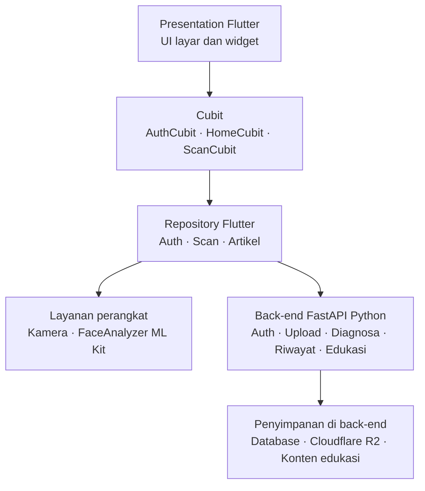
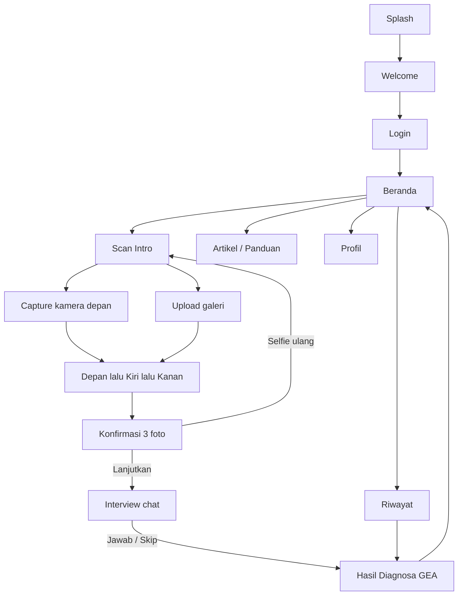

# 6. Rancangan Teknis Awal

Dokumen ini merancang aspek teknis aplikasi **PBL Skin Problem Detector** berbasis Flutter (mobile) dan **FastAPI** (back-end Python), mencakup arsitektur berlapis, state management Cubit, navigasi `go_router`, pengambilan tiga foto wajah, bimbingan kamera dengan ML Kit, autentikasi, penyimpanan data di server, serta diagnosa berdasarkan skala GEA.

---

## Daftar Fitur Utama

| No | Fitur | Keterangan singkat |
|---|---|---|
| 1 | Splash & Welcome | Layar pembuka dan pengenalan aplikasi sebelum masuk |
| 2 | Login / Registrasi | Autentikasi pengguna melalui API FastAPI (email/password) serta persetujuan Syarat & Ketentuan |
| 3 | Beranda | Menu scan, artikel, profil; navigasi bawah (bottom nav) |
| 4 | Artikel / Panduan | Konten edukasi seputar kulit dan skala GEA |
| 5 | Scan wajah 3 sudut | Ambil selfie **depan, kiri, kanan** melalui kamera depan, atau unggah dari galeri |
| 6 | Panduan pengambilan | Cek **pencahayaan**, **posisi wajah**, dan **sudut** secara realtime (ML Kit + analisis frame) |
| 7 | Konfirmasi foto | Pratinjau 3 foto; lanjut atau selfie ulang |
| 8 | Interview profil kulit | Chat singkat (gender, umur, sunscreen, tipe kulit, pola makan); dapat dilewati |
| 9 | Diagnosa GEA | Mengirim data ke back-end; menampilkan grade **0–5** beserta label dan deskripsi |
| 10 | Foto ulang | Foto pada sudut yang sama diganti jika diambil ulang |
| 11 | Riwayat sesi | Mengambil dan menampilkan kembali hasil analisis dari back-end |
| 12 | Penyimpanan server | Metadata sesi, hasil GEA, dan foto disimpan melalui FastAPI |

---

## 6.1 Rancangan Arsitektur Aplikasi Mobile (Flutter) dan Back-end (FastAPI)

### Mobile (Flutter)

Flutter digunakan untuk antarmuka Android. State dikelola dengan **Cubit** (`flutter_bloc`) untuk autentikasi, indeks navigasi beranda, serta sesi scan (tiga foto beserta sudutnya, tahapan interview, status proses, dan hasil GEA). Navigasi antarlayar memakai **`go_router`**. Komponen UI memakai **`shadcn_flutter`** dengan tema warna brand aplikasi.

Arsitektur mobile dipisah berlapis agar antarmuka tidak bergantung langsung pada detail teknis kamera maupun API:

| Lapisan | Folder | Peran |
|---|---|---|
| Presentation | `lib/presentation/` | Layar, widget, tema |
| Business | `lib/business/cubit/` | State management (Cubit) |
| Data | `lib/data/` | Model, service HTTP, repository |

Repository pada sisi Flutter memanggil endpoint FastAPI untuk login, unggah foto, permintaan diagnosa, riwayat, dan konten edukasi. Bimbingan kamera (pencahayaan/posisi/sudut) tetap berjalan di perangkat melalui ML Kit sebelum data dikirim ke server.

### Back-end (FastAPI — Python)

Back-end dibangun dengan **FastAPI** untuk menyediakan API REST yang menangani:

- autentikasi pengguna (registrasi, login, token akses);
- penerimaan dan penyimpanan tiga foto beserta sudutnya;
- proses diagnosa GEA (aturan klinis dan/atau inferensi model);
- penyimpanan metadata sesi dan hasil analisis;
- penyediaan riwayat sesi serta materi edukasi.

Layanan analisis di sisi server dipisahkan dari endpoint HTTP agar model (termasuk `.tflite` / runtime inferensi Python) dapat diganti tanpa mengubah kontrak API yang dikonsumsi Flutter.

### Diagram arsitektur

### Alur layar utama

- **Beranda** terhubung ke Scan Wajah, Artikel/Panduan, Riwayat, dan Profil.
- **Kamera** menampilkan tahapan depan → kiri → kanan dengan indikator pencahayaan, posisi wajah, dan sudut, lalu menuju konfirmasi dan hasil.
- **Riwayat** mengambil data dari FastAPI dan dapat membuka kembali detail Hasil Diagnosa GEA.

### Layar terkait

| Kelompok | Layar |
|---|---|
| Onboarding | Splash, Welcome, Login |
| Utama | Beranda, Artikel, Profil, Riwayat |
| Scan | Intro, Capture (kamera depan), Upload, Konfirmasi |
| Analisis | Interview, Hasil Diagnosa GEA |

### Penyimpanan data (FastAPI)

Penyimpanan data diposisikan di **back-end FastAPI**, bukan di database lokal perangkat:

- **Database server** (melalui FastAPI) menyimpan ID sesi, ID pengguna, waktu, label dan skor GEA, versi model atau aturan diagnosa, serta referensi lokasi tiga foto beserta sudutnya.
- **Cloudflare R2 Storage** menyimpan berkas foto wajah (depan, kiri, kanan); FastAPI mengelola unggah/unduh dan menyimpan URL atau object key foto pada database.
- **Konten edukasi** dikelola dan disajikan oleh back-end (misalnya file/konten terstruktur yang diekspos lewat API).
- Penghapusan sesi di back-end menghapus metadata dan ketiga foto terkait di Cloudflare R2.
- Foto yang diambil ulang mengunggah ulang ke Cloudflare R2 dan menggantikan foto pada sudut yang sama di server.
- Autentikasi pengguna (login/registrasi) dilakukan melalui endpoint FastAPI; aplikasi mobile menyimpan token akses untuk memanggil API yang dilindungi.

### Keadaan proses

| Keadaan | Arti |
|---|---|
| Siap | Menunggu input pengguna |
| Mengambil gambar | Kamera/galeri aktif atau sedang menyimpan foto |
| Mengunggah | Foto/metadata dikirim ke FastAPI |
| Memproses | Diagnosa / analisis di back-end sedang berjalan |
| Berhasil | Hasil GEA tersedia |
| Gagal | Terjadi error yang perlu ditindaklanjuti |

Tombol lanjut/analisis dinonaktifkan selama proses agar permintaan tidak berulang. Kegagalan izin, kamera, deteksi wajah, jaringan, API, model, dan penyimpanan ditangani dengan pesan yang menjelaskan tindakan berikutnya.

### Stack teknis

| Aspek | Pilihan |
|---|---|
| Framework mobile | Flutter (Dart) |
| UI | shadcn_flutter |
| State management | Cubit (`flutter_bloc`) |
| Navigasi | go_router |
| Kamera | `camera` (depan) + `image_picker` (galeri) |
| Bimbingan wajah | `google_mlkit_face_detection` |
| Back-end | FastAPI (Python) |
| Komunikasi | REST API (HTTP/JSON + upload multipart untuk foto) |
| Diagnosa | Skala GEA 0–5 (aturan klinis dan/atau model inferensi di server) |
| Autentikasi | FastAPI (login/registrasi + token akses) |
| Persistensi | Database pada back-end FastAPI; foto pada Cloudflare R2 Storage |

### Skala GEA

| Grade | Label | Ringkasan |
|---|---|---|
| 0 | Clear | Kulit bersih |
| 1 | Almost clear | Hampir bersih |
| 2 | Mild | Ringan |
| 3 | Moderate | Sedang |
| 4 | Severe | Berat |
| 5 | Very severe | Sangat berat |

Skala GEA (*Global Evaluation of Acne*) digunakan sebagai acuan penilaian tingkat keparahan jerawat yang ditampilkan pada layar hasil analisis.
