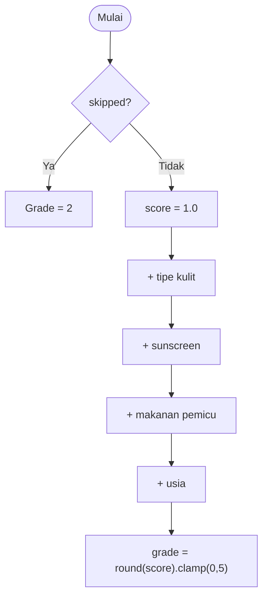

# Referensi Data

Seluruh model berada di `lib/data/models/` dan memakai `equatable` untuk
perbandingan nilai.

## Skala GEA (Global Evaluation of Acne)

Didefinisikan di `gea_scale.dart` sebagai tabel statis grade **0–5**.
`GeaScale.byGrade(n)` otomatis meng-*clamp* nilai ke rentang 0–5.

| Grade | Label (ID) | Label (EN) | Deskripsi |
|---|---|---|---|
| 0 | Bersih | Clear | Kulit bersih, tidak ada lesi sama sekali. |
| 1 | Hampir bersih | Almost clear | Hampir bersih; hanya ada beberapa komedo atau papula kecil. |
| 2 | Ringan | Mild | Ringan; mengenai kurang dari setengah wajah dengan komedo, papula, dan sedikit pustula. |
| 3 | Sedang | Moderate | Sedang; mengenai lebih dari setengah wajah dengan banyak komedo, papula, pustula, dan kadang 1 nodul. |
| 4 | Berat | Severe | Berat; jerawat inflamasi luas disertai banyak komedo, papula, pustula, serta nodul dan kista. |
| 5 | Sangat berat | Very severe | Sangat berat; jerawat meradang parah yang menutupi area luas dengan dominasi nodul dan kista. |

### Warna grade

`AppColors.gradeColor(g)` dan `AppColors.onGrade(g)` memetakan grade ke warna
(hijau → merah tua):

| Grade | Warna | Hex |
|---|---|---|
| 0 | hijau lembut | `#86C99B` |
| 1 | hijau kekuningan | `#B7C77A` |
| 2 | kuning | `#EAC95B` |
| 3 | oranye | `#EE9B4E` |
| 4 | oranye-merah | `#E0603F` |
| 5 | merah tua | `#B4342B` |

`onGrade(g)` mengembalikan putih untuk grade ≥ 4 (teks di atas latar gelap),
selain itu warna `ink`.

## `GeaResult`

Hasil akhir yang ditampilkan. Dibuat lewat `GeaResult.fromGrade(int)` yang
mengambil detail dari `GeaScale`.

| Field | Tipe | Keterangan |
|---|---|---|
| `grade` | `int` | 0–5 |
| `labelId` | `String` | Label bahasa Indonesia |
| `labelEn` | `String` | Label bahasa Inggris |
| `description` | `String` | Penjelasan grade |

Getter: `badgeTitle` → `"GEA <grade>"`, `badgeSubtitle` →
`"TINGKAT <LABEL_ID>"`.

## `InterviewAnswers`

Jawaban interview. Semua field opsional (bisa `null`).

| Field | Tipe |
|---|---|
| `gender` | `GenderOption?` |
| `age` | `int?` |
| `usesSunscreen` | `bool?` |
| `skinType` | `SkinTypeOption?` |
| `unhealthyFoodOften` | `bool?` |
| `skipped` | `bool` (default `false`) |

Enum:

- `GenderOption`: `male`, `female`, `preferNotToSay`
- `SkinTypeOption`: `oily`, `dry`, `combination`, `sensitive`, `normal`

## `ScanSession`

Satu sesi pemeriksaan (in-memory).

| Field | Tipe | Keterangan |
|---|---|---|
| `frontPath` | `String?` | Path foto tampak depan |
| `leftPath` | `String?` | Path foto sisi kiri |
| `rightPath` | `String?` | Path foto sisi kanan |
| `interview` | `InterviewAnswers` | Jawaban interview |
| `result` | `GeaResult?` | Hasil diagnosa |

- `hasAllPhotos` → `true` bila ketiga path terisi.
- `pathFor(SelfieAngle)` → path sesuai sudut.
- `copyWith(..., clearPhotos: true, clearResult: true)` untuk mengosongkan.

Enum `SelfieAngle`: `front`, `left`, `right`.

## `UserModel`

```dart
class UserModel {
  const UserModel({required this.email});
  final String email;
}
```

Mock sederhana — hanya menyimpan email (tidak ada token/backend).

## Aturan Diagnosa (rule-based)

`GeaDiagnosisService.diagnose()` mensimulasikan delay **700 ms**, lalu menghitung
skor. Ini **bukan** analisis citra.



| Faktor | Kondisi | Perubahan skor |
|---|---|---|
| Tipe kulit | `oily` / `sensitive` | **+1.5** |
| | `combination` | +1.0 |
| | `dry` | +0.5 |
| | `null` (tidak dijawab) | +0.5 |
| | `normal` | +0.0 |
| Sunscreen | `usesSunscreen == false` | +1.0 |
| | `usesSunscreen == true` | −0.5 |
| Makanan pemicu | `unhealthyFoodOften == true` | +1.0 |
| | `unhealthyFoodOften == false` | −0.3 |
| Usia | `< 18` | +0.5 |
| | `18–25` | +1.0 |
| | `> 35` | −0.3 |

Skor akhir dibulatkan dan di-*clamp* ke 0–5.

> **Catatan:** field `gender` dikumpulkan tetapi **belum** dipakai dalam
> perhitungan skor. Bila interview dilewati, grade langsung **2**.

## Analisis Wajah (ML Kit)

`FaceScanAnalyzer` menilai kualitas frame kamera saat pengambilan foto
(**bukan** klasifikasi lesi).

| Aspek | Aturan |
|---|---|
| Cahaya (`lightingOk`) | Kecerahan rata-rata antara **55–210** |
| Wajah ada (`facePresent`) | `headEulerAngleX` (pitch) absolut **< 28°** |
| Sudut depan (`angleOk`) | `headEulerAngleY` (yaw) absolut **≤ 14°** |
| Sudut samping | yaw absolut antara **16°–48°** |
| Sisi kanan | yaw berlawanan tanda dengan sisi kiri (`leftYawSign`) |

- Wajah terbesar (area bounding box) dipilih bila terdeteksi lebih dari satu.
- Kecerahan dihitung dari sampling ~4.000 byte luma plane.
- Konversi citra: **Android** → YUV_420_888 ke NV21; **iOS** → BGRA8888.
- `rememberLeftYaw()` menyimpan tanda yaw sisi kiri; dipakai `ScanCubit.leftYawSign`
  agar sisi kanan tervalidasi meski diambil di layar terpisah.

## Autentikasi (mock)

`AuthService.login()`:

1. Delay **400 ms**.
2. Jika S&K/privasi tidak dicentang → `AuthException`.
3. Jika email/password kosong → `AuthException`.
4. Selain itu → `UserModel(email: email.trim())`.
