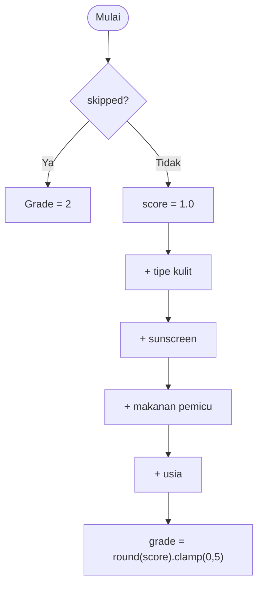

# Referensi Data

Seluruh model berada di `lib/data/models/` dan memakai `equatable` untuk
perbandingan nilai.

## Skala GEA (Global Evaluation of Acne)

Didefinisikan di `gea_scale.dart` sebagai tabel statis grade **0–5**.
`GeaScale.byGrade(n)` otomatis meng-*clamp* nilai ke rentang 0–5.

| Grade | Label (ID) | Label (EN) | Deskripsi |
|---|---|---|---|
| 0 | Bersih | Clear | Kulit bersih, tidak ada lesi sama sekali. |
| 1 | Hampir bersih | Almost clear | Hampir bersih; hanya ada beberapa komedo atau papula kecil. |
| 2 | Ringan | Mild | Ringan; mengenai kurang dari setengah wajah dengan komedo, papula, dan sedikit pustula. |
| 3 | Sedang | Moderate | Sedang; mengenai lebih dari setengah wajah dengan banyak komedo, papula, pustula, dan kadang 1 nodul. |
| 4 | Berat | Severe | Berat; jerawat inflamasi luas disertai banyak komedo, papula, pustula, serta nodul dan kista. |
| 5 | Sangat berat | Very severe | Sangat berat; jerawat meradang parah yang menutupi area luas dengan dominasi nodul dan kista. |

### Pemetaan label model ML → GEA (IGA0–IGA4)

Model di `machine-learning/` dan `model-comparator/` mengeluarkan **5 kelas IGA
(`IGA0`–`IGA4`)** — lihat `"labels"` di
[`model-comparator/models.json`](../model-comparator/models.json). Aplikasi
memakai **6 tingkat GEA 0–5**, sehingga pemetaan resmi proyek adalah **1:1 tanpa
offset**: urutan IGA sama dengan grade GEA, dan nama labelnya memang identik.

| Label model | IGA | Grade GEA | Label GEA |
|---|---|---|---|
| `IGA0` | 0 | **0** | Bersih |
| `IGA1` | 1 | **1** | Hampir bersih |
| `IGA2` | 2 | **2** | Ringan |
| `IGA3` | 3 | **3** | Sedang |
| `IGA4` | 4 | **4** | Berat |

Aturan yang menyertainya:

- **Grade GEA 5 (Sangat berat) tidak punya kelas model.** Model 5 kelas tidak
  akan pernah mengeluarkan grade 5. Jangan memaksa `IGA4` menjadi 5 — grade 5
  hanya boleh berasal dari penilaian manual/eskalasi dokter, atau aturan
  tambahan yang harus disepakati terpisah.
- **Indeks output model = indeks tabel.** `argmax` ke-0 berarti `IGA0` → GEA 0,
  dan seterusnya; jangan mengurutkan ulang label.
- **Kelas ke-6 Roboflow (`IGA3_Level3`)** digabung ke `IGA3` saat training model
  5 kelas (dataset Roboflow punya 6 kelas, model yang dipakai di comparator
  punya 5). Lihat [`machine-learning/README.md`](../machine-learning/README.md).
- **Model 4 kelas (Hayashi)** seperti `machine-learning/models/custom_cnn_1.tflite`
  tidak mengikuti skala IGA. Petakan ke IGA lebih dulu, baru ke GEA, dan
  validasi pemetaannya bersama tim ML — jangan langsung menempelkan ke grade.

Pemetaan ini sekarang **dipakai kode**: `backend/app/services/ml_service.py`
menyimpan `IGA_TO_GEA = (0, 1, 2, 3, 4)` (argmax → grade GEA) dan aplikasi
memakai `GeaResult.fromGrade(prediction.grade, source: ResultSource.ml)`.

```python
# backend/app/services/ml_service.py
IGA_LABELS = ("IGA0", "IGA1", "IGA2", "IGA3", "IGA4")  # urutan output model
IGA_TO_GEA = (0, 1, 2, 3, 4)                          # GEA 5 tidak pernah muncul
```

Artifact yang dipakai: `backend/app/ml/artifacts/dermascan_custom_cnn.tflite`
(salinan dari `machine-learning/Fadillah-Dama/deep_learning/`), dengan
`dermascan_custom_cnn_meta.json` sebagai catatan asal-usul dan kontrak
input/output. Endpoint: `POST /ml/predict` (lihat [api.md](api.md)).

Kalau inferensi gagal (offline/`503`), hasil jatuh ke aturan interview di
"Aturan Diagnosa" dan ditandai `ResultSource.ruleBased`.

### Warna grade

`AppColors.gradeColor(g)` dan `AppColors.onGrade(g)` memetakan grade ke warna
(hijau → merah tua):

| Grade | Warna | Hex |
|---|---|---|
| 0 | hijau lembut | `#86C99B` |
| 1 | hijau kekuningan | `#B7C77A` |
| 2 | kuning | `#EAC95B` |
| 3 | oranye | `#EE9B4E` |
| 4 | oranye-merah | `#E0603F` |
| 5 | merah tua | `#B4342B` |

`onGrade(g)` mengembalikan putih untuk grade ≥ 4 (teks di atas latar gelap),
selain itu warna `ink`.

## `GeaResult`

Hasil akhir yang ditampilkan. Dibuat lewat `GeaResult.fromGrade(int)` yang
mengambil detail dari `GeaScale`.

| Field | Tipe | Keterangan |
|---|---|---|
| `grade` | `int` | 0–5 |
| `labelId` | `String` | Label bahasa Indonesia |
| `labelEn` | `String` | Label bahasa Inggris |
| `description` | `String` | Penjelasan grade |
| `source` | `ResultSource` | `ml` bila dari CNN, `ruleBased` bila dari interview (bawaan) |

Getter: `badgeTitle` → `"GEA <grade>"`, `badgeSubtitle` →
`"TINGKAT <LABEL_ID>"`.

## `InterviewAnswers`

Jawaban interview. Semua field opsional (bisa `null`).

| Field | Tipe |
|---|---|
| `gender` | `GenderOption?` |
| `age` | `int?` |
| `usesSunscreen` | `bool?` |
| `skinType` | `SkinTypeOption?` |
| `unhealthyFoodOften` | `bool?` |
| `skipped` | `bool` (default `false`) |

Enum:

- `GenderOption`: `male`, `female`, `preferNotToSay`
- `SkinTypeOption`: `oily`, `dry`, `combination`, `sensitive`, `normal`

## `ScanSession`

Satu sesi pemeriksaan (in-memory).

| Field | Tipe | Keterangan |
|---|---|---|
| `frontPath` | `String?` | Path foto tampak depan |
| `leftPath` | `String?` | Path foto sisi kiri |
| `rightPath` | `String?` | Path foto sisi kanan |
| `interview` | `InterviewAnswers` | Jawaban interview |
| `result` | `GeaResult?` | Hasil diagnosa |

- `hasAllPhotos` → `true` bila ketiga path terisi.
- `pathFor(SelfieAngle)` → path sesuai sudut.
- `photoPaths` → daftar path yang sudah ada, urut depan → kiri → kanan; dipakai
  sebagai berkas `POST /ml/predict` (1–3 foto).
- `copyWith(..., clearPhotos: true, clearResult: true)` untuk mengosongkan.

Enum `SelfieAngle`: `front`, `left`, `right`.

## `UserModel`

Hasil parsing respons autentikasi (`AuthResponse`): `access_token` + `user`.

| Field | Tipe | Keterangan |
|---|---|---|
| `email` | `String` | Email akun |
| `fullName` | `String?` | Nama tampilan (`full_name`), `null` bila tidak diisi |
| `accessToken` | `String?` | JWT dari `access_token`; juga disimpan di `ApiClient` |

`UserModel.fromAuthJson(json)` membaca `json['access_token']` dan
`json['user']['email']` / `json['user']['full_name']`. Token **tidak** disimpan
ke storage permanen — menutup aplikasi berarti harus login ulang.

## Inferensi CNN (sumber utama grade)

`ScanRepository.diagnose()` mengirim foto sesi ke `POST /ml/predict`; backend
menjalankan `dermascan_custom_cnn.tflite` (lihat `backend/app/services/ml_service.py`).

| Tahap | Aturan |
|---|---|
| Input model | `[1, 160, 160, 3]` float32, RGB, **piksel 0–255** |
| Normalisasi | Di dalam model (`layers.Rescaling(1./255)`) — API tidak membagi 255 |
| Resize | `Image.BILINEAR` ke 160×160 (setara `image_size=(160,160)` saat training) |
| Orientasi | EXIF di-*transpose* dulu (`ImageOps.exif_transpose`) |
| Output | softmax 5 kelas, urut `IGA0`…`IGA4` |
| Agregasi | `mean` probabilitas semua foto → `argmax` → `IGA_TO_GEA` → grade GEA |
| Grade 5 | Tidak mungkin dari model (hanya 5 kelas) |
| Kegagalan | `MlException` → fallback "Aturan Diagnosa" + `ResultSource.ruleBased` |

Kontrak input/output tercatat di
`backend/app/ml/artifacts/dermascan_custom_cnn_meta.json`. Regresi preprocessing
dikunci oleh `backend/tests/test_ml.py::test_predictions_are_stable_for_a_fixed_photo`
(nilai softmax untuk gambar tetap harus tidak berubah).

## Aturan Diagnosa (rule-based)

`GeaDiagnosisService.diagnose()` mensimulasikan delay **700 ms**, lalu menghitung
skor. Ini **bukan** analisis citra; sekarang berperan sebagai **fallback** bila
`POST /ml/predict` gagal (offline, `4xx`, `503`) atau belum ada foto.



| Faktor | Kondisi | Perubahan skor |
|---|---|---|
| Tipe kulit | `oily` / `sensitive` | **+1.5** |
| | `combination` | +1.0 |
| | `dry` | +0.5 |
| | `null` (tidak dijawab) | +0.5 |
| | `normal` | +0.0 |
| Sunscreen | `usesSunscreen == false` | +1.0 |
| | `usesSunscreen == true` | −0.5 |
| Makanan pemicu | `unhealthyFoodOften == true` | +1.0 |
| | `unhealthyFoodOften == false` | −0.3 |
| Usia | `< 18` | +0.5 |
| | `18–25` | +1.0 |
| | `> 35` | −0.3 |

Skor akhir dibulatkan dan di-*clamp* ke 0–5.

> **Catatan:** field `gender` dikumpulkan tetapi **belum** dipakai dalam
> perhitungan skor. Bila interview dilewati, grade langsung **2**.

## Analisis Wajah (ML Kit)

`FaceScanAnalyzer` menilai kualitas frame kamera saat pengambilan foto
(**bukan** klasifikasi lesi).

| Aspek | Aturan |
|---|---|
| Cahaya (`lightingOk`) | Kecerahan rata-rata antara **55–210** |
| Wajah ada (`facePresent`) | `headEulerAngleX` (pitch) absolut **< 28°** |
| Sudut depan (`angleOk`) | `headEulerAngleY` (yaw) absolut **≤ 14°** |
| Sudut samping | yaw absolut antara **16°–48°** |
| Sisi kanan | yaw berlawanan tanda dengan sisi kiri (`leftYawSign`) |

- Wajah terbesar (area bounding box) dipilih bila terdeteksi lebih dari satu.
- Kecerahan dihitung dari sampling ~4.000 byte luma plane.
- Konversi citra: **Android** → YUV_420_888 ke NV21; **iOS** → BGRA8888.
- `rememberLeftYaw()` menyimpan tanda yaw sisi kiri; dipakai `ScanCubit.leftYawSign`
  agar sisi kanan tervalidasi meski diambil di layar terpisah.

## Autentikasi

Autentikasi memakai backend FastAPI (kontrak: `backend/openapi.json`). Akun demo
hasil seed backend: **`pengguna@gmail.com`** / **`skinscan123`**.

| Alur UI | File service | Endpoint |
|---|---|---|
| Email + kata sandi | `auth/auth_login.dart` | `POST /auth/login` |
| Google Sign-In | `auth/auth_google.dart` | `POST /auth/google` |
| Registrasi — layarnya belum ada | `auth/auth_register.dart` | `POST /auth/register` |

`AuthService` (facade) melakukan:

1. Menolak submit bila S&K/privasi belum dicentang → `AuthException`, tanpa
   memanggil jaringan.
2. Memanggil file endpoint sesuai alur. Body selalu berisi
   `accepted_terms: true` dan `accepted_privacy: true`, karena `LoginScreen`
   menyalakan kedua centang sebelum submit.
3. Menyimpan `access_token` ke `ApiClient` (`setAccessToken`), sehingga request
   berikutnya dengan `auth: true` otomatis membawa `Authorization: Bearer`.
4. Bila status bukan `200`/`201` → `AuthException` berisi string `detail` dari
   server (mis. `Email atau kata sandi salah. Periksa kembali.`). Bila jaringan
   gagal → `'Tidak bisa menghubungi server. Cek koneksi internet.'`.

Validasi **"tidak boleh kosong"** dan **format email** dikerjakan di
`LoginScreen` (lihat `alur-pengguna.md` §2) agar pengguna dapat umpan balik
langsung; service hanya meneruskan keputusan server.

Untuk widget test, `AuthService.mockRemoteAuth` (`@visibleForTesting`) diset
`true` agar Google SDK dan HTTP dilewati — lihat `test/login_screen_test.dart`.
